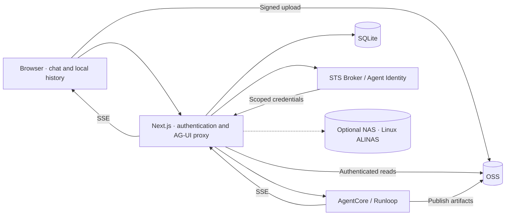

# AgentCore Chat

English | [简体中文](README.zh-CN.md)

A self-hosted chat application for Alibaba Cloud AgentCore, built with Next.js App Router, React, and TypeScript. Connect an AG-UI streaming endpoint to a chat interface with authentication, conversation management, file uploads, and artifact previews.

This repository contains the UI and Next.js server. The Agent runtime, STS Broker, and cloud storage are deployed separately. No credentials or hosted demo backend are included.

## Features

- Streaming Markdown, code highlighting, tables, and math with react-ai-renderer.
- Tool execution timeline, stop, retry, and regenerate.
- Conversation search, pinning, projects, Markdown export, and a conversation minimap.
- Responsive layouts, light/dark themes, and configurable branding.
- Better Auth + SQLite email/password authentication. Alibaba Cloud RAM OAuth/OIDC is temporarily disabled; its implementation is retained for restoration.
- OSS uploads, including pasted images: up to 10 attachments per message, 32 MiB per file.
- Image, PPTX, DOCX, PDF, Markdown, and text previews.
- OSS artifact delivery and optional NAS/AgenticFS reads.

History is stored in browser localStorage, partitioned by signed-in user. It does not sync across devices; clearing site data removes it. Accounts and sessions are stored in server-side SQLite. Request messages and history are sent to the configured Agent.

## Architecture



The server derives user-scoped upstream conversation IDs and file directories. It sends workspace instructions as a system message and trusted identifiers through `forwardedProps`; `context` is currently empty. The upstream `X-AgentCore-Session-ID` matches the derived conversation ID.

Tools execute in the Agent backend. Client-side Agent tools, approval interrupts, and custom Agent state synchronization are not implemented. Prompts alone cannot enforce isolation: the backend must validate the caller and enforce filesystem boundaries.

## Quick start

You need Node.js 20.19+, npm, and an AgentCore-compatible AG-UI SSE endpoint with an API key. File features additionally require a compatible Runloop, STS Broker, and cloud permissions.

```bash
npm ci
npm run auth:init
```

`auth:init` creates `.env.local` from `.env.example` when absent, generates the authentication secret, and preserves existing nonempty values. Edit that file:

```dotenv
AGENT_API_BASE_URL=https://your-agent-host
AGENT_API_PATH=/ag-ui/agent
AGENT_API_KEY=replace-with-your-api-key
# Example: must match Runloop and be under /mnt/oss/data/.
AGENTCORE_ARTIFACT_ROOT=/mnt/oss/data/users
BETTER_AUTH_URL=http://127.0.0.1:3000
```

Replace the API key placeholder. In default OSS mode, `AGENTCORE_ARTIFACT_ROOT` is required even for text chat because every request derives a workspace directory. Text-only chat does not require an OSS bucket; uploads and artifact reads do.

```bash
npm run dev
```

Open [the local login page](http://127.0.0.1:3000/login) and create an account. To change ports, use `npm run dev -- --port 3001` and update `BETTER_AUTH_URL`. Restart after changing server environment variables.

## Configuration

See [.env.example](.env.example) for the main template.

| Variable | Purpose |
| --- | --- |
| `AGENT_API_BASE_URL` / `AGENT_API_PATH` | Agent address; path defaults to `/ag-ui/agent` |
| `AGENT_API_KEY` | Server-only gateway key, sent as `x-api-key` |
| `BETTER_AUTH_SECRET` / `BETTER_AUTH_URL` | Stable authentication secret and canonical application origin |
| `AUTH_DATABASE_PATH` | SQLite path; defaults to `./data/auth.sqlite` |
| `FILE_STORAGE_BACKEND` | `oss` (default) or `nas` |
| `FILE_ACCESS_MODE` | `user` (default) or explicitly shared reads with `shared` |
| `AGENTCORE_ARTIFACT_ROOT` | OSS delivery root matching Runloop, under `/mnt/oss/data/` |
| `OSS_BUCKET` / `OSS_REGION` / `OSS_OBJECT_PREFIX` | Bucket, region, and mounted object prefix |
| `STS_BROKER_URL` | Optional override; defaults to Agent base URL plus `/v1/sts` |
| `STS_BROKER_API_KEY` | Optional override; otherwise uses `AGENT_API_KEY` |
| `STS_BROKER_KEY_ID` / `STS_BROKER_SECRET` | Optional paired HMAC settings matching the Broker |
| `AGENT_IDENTITY_AUTH_MODE` | `user_id` (default), `app_jwt`, or `login_provider` |
| `ALIYUN_OAUTH_CLIENT_ID` / `ALIYUN_OAUTH_CLIENT_SECRET` | Currently ignored: RAM OAuth login is disabled in source |

### File storage

For OSS file features, configure your resources:

```dotenv
FILE_STORAGE_BACKEND=oss
FILE_ACCESS_MODE=user
OSS_BUCKET=your-bucket-name
OSS_REGION=oss-cn-hangzhou
OSS_OBJECT_PREFIX=agentcore/files
```

The prefix must match the Agent's OSS mount mapping. Runloop must support trusted user/session identifiers, `publish_artifact` for OSS outputs, and attachment download tickets for uploads. Uploads still use OSS when the workspace backend is NAS.

The server obtains scoped temporary credentials through the Broker. The browser receives a short-lived, single-object PUT URL; GET tickets for Agent input files are passed server-to-server. Configure OSS CORS to allow the application's origin, `PUT`, and the `Content-Type` header. The [OSS read policy](deploy/oss/workload-oss-read.json) is a template for reads, not a complete upload permission policy.

In `user` mode, the application checks user directory ownership. In `shared` mode, signed-in users can read the configured shared scope, including other users' files within it. Use it only for intentionally shared content.

NAS reads require a VPC-connected Linux environment, the ALINAS client, mount privileges, and RAM policies. macOS cannot perform these mounts. See the [NAS guide](docs/nas-agenticfs-compatibility.md) for `NAS_*` variables.

### Authentication and branding

Email/password login works without cloud OAuth. Email ownership verification and email-based password recovery are not implemented. RAM OAuth login and its UI entry are temporarily disabled; setting OAuth environment variables does not enable them. The retained OAuth implementation requires an application and exact callback URLs when restored.

`app_jwt` requires a public HTTPS issuer, cloud trust configuration, and persistent signing keys initialized with `npm run identity:init`. See the [authentication](docs/auth-setup.md) and [JWT](docs/app-jwt-identity.md) guides.

Branding defaults are in [src/config/frontend.ts](src/config/frontend.ts). Use the `NEXT_PUBLIC_*` variables in `.env.example` to override titles, welcome text, theme, and accent colors. These values are embedded in browser bundles at build time: never put secrets in them, and rebuild after changes. Bilingual READMEs do not imply a fully localized application UI.

## Preview and request limits

| Format | Behavior |
| --- | --- |
| PNG, JPEG, GIF, WebP, AVIF, SVG | Image preview and download |
| PPTX / DOCX | Local parsing in isolated sandbox iframes; complex layouts may differ from Office |
| PDF | Browser viewer or download |
| Markdown / text / JSON / CSV / source files | Markdown rendering or text display; HTML is shown as source |
| Other formats, including XLSX and legacy PPT/DOC | Download |

General previews are limited to 30 MiB; text and Markdown to 2 MiB. Larger files remain downloadable. Office previews also limit pages, ZIP entries, and declared uncompressed size. Documents are not sent to third-party preview websites.

The chat API accepts at most 1,000,000 request bytes, 400 messages, and 100,000 characters of content per message. There is no fixed application-level total chat timeout; Agent and infrastructure limits still apply. SSE heartbeats do not extend those limits.

## Development and tests

```bash
npm run lint
npm run typecheck
npm test
npm run build
npm run test:e2e
```

Browser tests require local Google Chrome. Playwright starts or reuses port 3000. Initialize authentication first and use an isolated development configuration: tests create accounts and generally mock Agent/file responses. They do not validate deployed cloud permissions.

Optional live checks actually call your configured services and may create accounts or files:

```bash
# Start the application first.
npm run test:live
LIVE_AGENT=1 npm run test:e2e -- tests/e2e/live.spec.ts
LIVE_OSS=1 npm run test:e2e -- tests/e2e/shared-file-preview.spec.ts
LIVE_AGENT_IMAGE=1 npm run test:e2e -- tests/e2e/live-image.spec.ts
```

Live OSS tests require matching storage configuration and test files. Traces, screenshots, logs, and reports may contain conversation content or resource identifiers; keep them private.

## Deployment

```bash
npm ci
npm run build
npm start
```

- The default start command binds to `127.0.0.1`. Use a reverse proxy or explicitly configure the bind address for your container/network.
- Use HTTPS and the correct public `BETTER_AUTH_URL`. Preserve the public Host header, disable SSE buffering, and configure suitable proxy timeouts.
- Persist `data/`, the authentication secret, and any JWT keyring. SQLite needs a suitable persistent filesystem; this repository does not provide a distributed database deployment.
- Authentication is built in. Configure registration/access policy and application-level request limits for public deployment; authentication rate limits are not chat/upload quotas.
- Enforce user isolation in the remote Agent runtime too.
- Run installation scripts: `postinstall` patches a specific renderer version and generates Office viewer bundles in `public/file-viewers/`. Deploy those assets with `public/`.
- Keep environment files, databases, private keys, and runtime artifacts out of source control. Never use `NEXT_PUBLIC_*` for credentials.

## Project layout and documentation

| Path | Contents |
| --- | --- |
| `src/app/` | Pages and authentication, chat, upload, and file routes |
| `src/components/` / `src/hooks/` | Chat UI, previews, and conversation state |
| `src/lib/` | AG-UI/SSE, authentication, identity, and storage |
| `src/config/frontend.ts` | Branding and themes |
| `scripts/` | Setup, viewer builds, patches, and live checks |
| `tests/` | Unit, integration, and browser tests |
| `deploy/` | Example cloud read policies |

Detailed guides are currently in Chinese:

- [Authentication and identity](docs/auth-setup.md)
- [Application JWT identity](docs/app-jwt-identity.md)
- [File ownership and isolation](docs/agent-file-isolation.md)
- [NAS / AgenticFS integration](docs/nas-agenticfs-compatibility.md)
- [Example office-assistant prompt](prompts/office-assistant.txt)

These guides include historical integration notes. Assess readiness against the current source and validation in your target environment.

## License

No license has been selected; the repository currently has no `LICENSE` file. Add your chosen license before publishing an open-source release.
