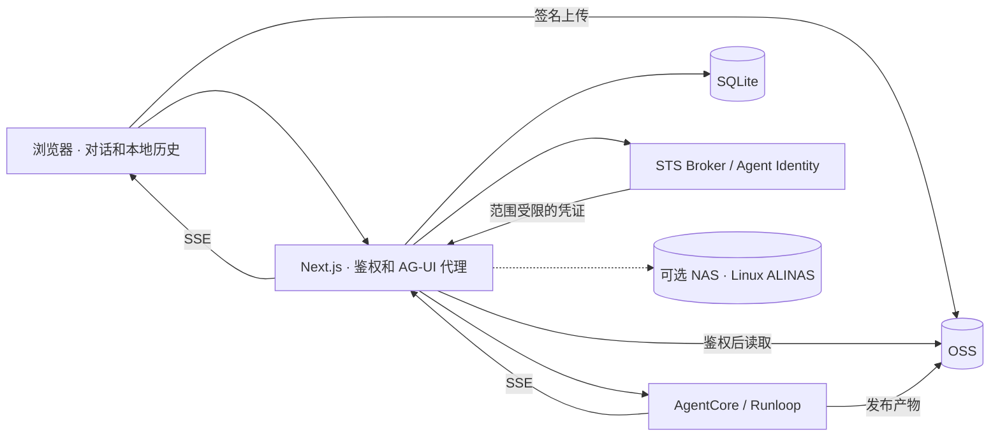

# AgentCore Chat

[English](README.md) | 简体中文

面向 Alibaba Cloud AgentCore 的自托管聊天应用，基于 Next.js App Router、React 和 TypeScript 构建。通过 AG-UI 流式接口连接 Agent，提供登录认证、对话管理、文件上传和产物预览。

本仓库包含聊天前端及 Next.js 服务端。Agent 运行时、STS Broker 和云存储需要单独部署，不附带凭证或可直接使用的在线演示后端。

## 功能

- 使用 react-ai-renderer 渲染流式 Markdown、代码高亮、表格和公式。
- 工具执行时间线，以及停止、重试、重新生成。
- 对话搜索、置顶、项目整理、Markdown 导出和长对话 minimap。
- 响应式布局、浅色 / 深色主题和品牌配置。
- Better Auth + SQLite 邮箱密码登录。阿里云 RAM OAuth/OIDC 暂时禁用，保留实现以便恢复。
- OSS 文件直传及粘贴图片：每条消息最多 10 个附件，单文件不超过 32 MiB。
- 图片、PPTX、DOCX、PDF、Markdown 和文本预览。
- OSS 文件交付，以及可选的 NAS / AgenticFS 读取。

聊天记录按登录用户分区保存在浏览器 localStorage 中，不跨设备同步，清理站点数据后会丢失。账号和会话保存在服务端 SQLite 中。请求中的消息与历史会发送至配置的 Agent。

## 架构



服务端根据登录用户派生上游会话 ID 和文件目录，通过 system 消息传递工作区说明，通过 `forwardedProps` 传递可信标识；当前 `context` 为空。上游 `X-AgentCore-Session-ID` 与派生后的会话 ID 一致。

工具在 Agent 后端执行。当前未实现客户端 Agent 工具、审批中断和自定义 Agent state 同步。提示词本身不能提供隔离，后端必须校验调用方并强制执行文件系统访问边界。

## 快速开始

需要 Node.js 20.19+、npm，以及兼容 AgentCore 的 AG-UI SSE 接口和 API Key。文件功能还需要兼容的 Runloop、STS Broker 和云资源权限。

```bash
npm ci
npm run auth:init
```

`auth:init` 会在 `.env.local` 不存在时从 `.env.example` 创建配置，生成认证密钥，并保留已有非空配置。编辑该文件：

```dotenv
AGENT_API_BASE_URL=https://your-agent-host
AGENT_API_PATH=/ag-ui/agent
AGENT_API_KEY=replace-with-your-api-key
# 仅为示例：必须与 Runloop 一致，且位于 /mnt/oss/data/ 下。
AGENTCORE_ARTIFACT_ROOT=/mnt/oss/data/users
BETTER_AUTH_URL=http://127.0.0.1:3000
```

替换 API Key 占位符。默认 OSS 模式下，即使只进行文本对话也必须配置 `AGENTCORE_ARTIFACT_ROOT`，因为每次请求都会派生工作区目录。纯文本对话无需 OSS 桶，上传和文件读取则需要。

```bash
npm run dev
```

打开 [本地登录页](http://127.0.0.1:3000/login) 并注册账号。更换端口可使用 `npm run dev -- --port 3001`，同时更新 `BETTER_AUTH_URL`。修改服务端环境变量后重启服务。

## 配置

主要配置模板见 [.env.example](.env.example)。

| 变量 | 用途 |
| --- | --- |
| `AGENT_API_BASE_URL` / `AGENT_API_PATH` | Agent 地址，路径默认 `/ag-ui/agent` |
| `AGENT_API_KEY` | 仅服务端使用的网关密钥，以 `x-api-key` 发送 |
| `BETTER_AUTH_SECRET` / `BETTER_AUTH_URL` | 稳定的认证密钥和应用规范源地址 |
| `AUTH_DATABASE_PATH` | SQLite 路径，默认 `./data/auth.sqlite` |
| `FILE_STORAGE_BACKEND` | `oss`（默认）或 `nas` |
| `FILE_ACCESS_MODE` | `user`（默认），或显式启用共享读取的 `shared` |
| `AGENTCORE_ARTIFACT_ROOT` | 与 Runloop 一致的 OSS 交付根，位于 `/mnt/oss/data/` 下 |
| `OSS_BUCKET` / `OSS_REGION` / `OSS_OBJECT_PREFIX` | 桶、区域和挂载对应的对象前缀 |
| `STS_BROKER_URL` | 可选覆盖，默认 Agent 基础地址加 `/v1/sts` |
| `STS_BROKER_API_KEY` | 可选覆盖，否则复用 `AGENT_API_KEY` |
| `STS_BROKER_KEY_ID` / `STS_BROKER_SECRET` | 可选、成对配置的 HMAC 参数，需与 Broker 一致 |
| `AGENT_IDENTITY_AUTH_MODE` | `user_id`（默认）、`app_jwt` 或 `login_provider` |
| `ALIYUN_OAUTH_CLIENT_ID` / `ALIYUN_OAUTH_CLIENT_SECRET` | 当前不读取：源码中已禁用 RAM OAuth 登录 |

### 文件存储

使用 OSS 文件功能时，配置自己的资源：

```dotenv
FILE_STORAGE_BACKEND=oss
FILE_ACCESS_MODE=user
OSS_BUCKET=your-bucket-name
OSS_REGION=oss-cn-hangzhou
OSS_OBJECT_PREFIX=agentcore/files
```

前缀必须与 Agent 的 OSS 挂载映射一致。Runloop 需支持可信用户 / 会话标识、用于 OSS 输出的 `publish_artifact`，以及用于上传附件的下载票据。即使工作区后端为 NAS，上传仍使用 OSS。

服务端通过 Broker 获取范围受限的临时凭证。浏览器只收到短期、单对象的 PUT URL；Agent 输入文件的 GET 票据通过服务端传递。OSS CORS 需允许应用源地址、`PUT` 和 `Content-Type` 请求头。[OSS 读取策略](deploy/oss/workload-oss-read.json) 仅为读取模板，并非完整的上传权限策略。

`user` 模式下，应用检查用户目录归属。`shared` 模式下，已登录用户可以读取配置的共享范围，包括其中其他用户的文件；仅在明确需要共享内容时启用。

NAS 读取需要可连接 VPC 的 Linux 环境、ALINAS 客户端、挂载权限和 RAM 策略，macOS 无法执行这些挂载。`NAS_*` 变量见 [NAS 接入说明](docs/nas-agenticfs-compatibility.md)。

### 认证与品牌

邮箱密码登录无需配置云端 OAuth。目前未实现邮箱所有权验证和邮件找回密码。RAM OAuth 登录及页面入口暂时禁用，配置 OAuth 环境变量也不会启用。相关实现保留，恢复后仍需创建应用并配置精确回调地址。

`app_jwt` 需要公开 HTTPS 签发方、云端信任配置，以及通过 `npm run identity:init` 初始化并持久保存的签名密钥。详见 [登录与身份接入](docs/auth-setup.md) 和 [JWT 接入](docs/app-jwt-identity.md)。

品牌默认值位于 [src/config/frontend.ts](src/config/frontend.ts)。通过 `.env.example` 中的 `NEXT_PUBLIC_*` 变量可覆盖标题、欢迎文案、主题和强调色。这些值在构建时写入浏览器包，不能存放秘密，修改后需重新构建。README 双语版本不代表应用界面已完成全面国际化。

## 预览与请求限制

| 格式 | 行为 |
| --- | --- |
| PNG、JPEG、GIF、WebP、AVIF、SVG | 图片预览和下载 |
| PPTX / DOCX | 在隔离 sandbox iframe 中本地解析，复杂版式可能与 Office 不同 |
| PDF | 浏览器阅读器或下载 |
| Markdown / 文本 / JSON / CSV / 源代码 | Markdown 渲染或文本展示，HTML 按源代码展示 |
| 其他格式，包括 XLSX 和旧版 PPT/DOC | 下载 |

普通预览上限 30 MiB，文本与 Markdown 为 2 MiB，超限仍可下载。Office 预览还限制页数、ZIP 条目数和声明解压大小。文档不会发送到第三方预览网站。

聊天 API 请求体最大 1,000,000 字节，最多 400 条消息，每条消息正文最多 100,000 字符。应用不设置固定的对话总时长限制，但 Agent 和部署平台的限制仍然生效，SSE 心跳不会延长这些限制。

## 开发与测试

```bash
npm run lint
npm run typecheck
npm test
npm run build
npm run test:e2e
```

浏览器测试需要本机 Google Chrome。Playwright 会启动或复用 3000 端口。请先初始化认证并使用独立开发配置：测试会创建账号，通常使用模拟 Agent / 文件响应，不能证明云端权限已通过验证。

以下可选联调会实际调用配置的服务，并可能创建账号或文件：

```bash
# 先启动应用。
npm run test:live
LIVE_AGENT=1 npm run test:e2e -- tests/e2e/live.spec.ts
LIVE_OSS=1 npm run test:e2e -- tests/e2e/shared-file-preview.spec.ts
LIVE_AGENT_IMAGE=1 npm run test:e2e -- tests/e2e/live-image.spec.ts
```

真实 OSS 测试需要匹配的存储配置和测试文件。Trace、截图、日志及报告可能包含对话内容或资源标识，不应公开提交。

## 部署

```bash
npm ci
npm run build
npm start
```

- 默认启动命令监听 `127.0.0.1`，可使用反向代理，或按容器 / 网络需要显式配置监听地址。
- 使用 HTTPS 和正确的公网 `BETTER_AUTH_URL`；保留公网 Host 请求头、关闭 SSE 缓冲，并配置适当的代理超时。
- 持久保存 `data/`、认证密钥和 JWT 密钥文件。SQLite 需要适合的持久文件系统，本仓库不提供分布式数据库部署方案。
- 应用已内置鉴权。公开服务时需配置注册 / 访问策略及应用级请求限制；认证限流不等于聊天或上传配额。
- 远端 Agent 运行时也必须强制执行用户隔离。
- 执行安装脚本：`postinstall` 为特定渲染器版本打补丁，并在 `public/file-viewers/` 生成 Office 预览 bundle，部署时需随 `public/` 一起发布。
- 不要将环境文件、数据库、私钥和运行产物加入版本控制，也不要用 `NEXT_PUBLIC_*` 存储凭证。

## 项目结构与文档

| 路径 | 内容 |
| --- | --- |
| `src/app/` | 页面及认证、聊天、上传、文件接口 |
| `src/components/` / `src/hooks/` | 聊天界面、预览和对话状态 |
| `src/lib/` | AG-UI/SSE、认证、身份和存储 |
| `src/config/frontend.ts` | 品牌和主题 |
| `scripts/` | 初始化、预览器构建、补丁和真实接口检查 |
| `tests/` | 单元、集成和浏览器测试 |
| `deploy/` | 云资源读取策略示例 |

详细文档目前为中文：

- [登录与用户身份](docs/auth-setup.md)
- [本站 JWT 身份接入](docs/app-jwt-identity.md)
- [文件归属与隔离](docs/agent-file-isolation.md)
- [NAS / AgenticFS 接入](docs/nas-agenticfs-compatibility.md)
- [办公助手提示词示例](prompts/office-assistant.txt)

这些文档包含历史联调记录；判断部署是否就绪时，应以当前源码和目标环境的验证结果为准。

## 许可证

目前尚未选择许可证，仓库中没有 `LICENSE` 文件。作为开源版本发布前，需要补充选定的许可证。
