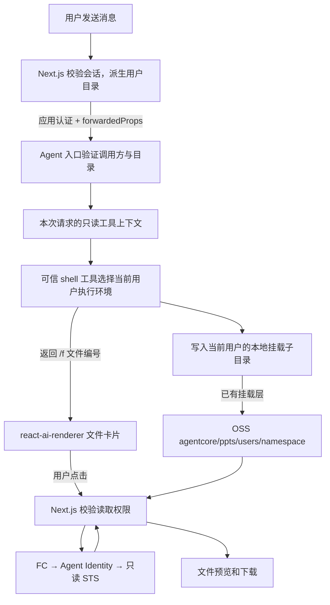

# Agent 文件：共享预览与用户隔离方案

> OSS 写入已采用 AgenticFS 工作区 + `publish_artifact` 受控发布；当前 NAS / AgenticFS 直接交付模式及环境变量见 [NAS 接入说明](nas-agenticfs-compatibility.md)。

## 当前已经实现的共享模式

共享模式的 `.env.local` 配置示例（请替换为自己的资源）：

```dotenv
FILE_ACCESS_MODE=shared
OSS_BUCKET=YOUR_BUCKET
OSS_REGION=oss-cn-hangzhou
OSS_OBJECT_PREFIX=agentcore/ppts
```

浏览器仍传 Agent 文件路径，Next.js 负责映射，不能把系统挂载路径直接当成 OSS key：

```text
/mnt/oss/data/大语言模型LLM全景解读.pptx
  → oss://YOUR_BUCKET/agentcore/ppts/大语言模型LLM全景解读.pptx
```

`shared` 表示所有已登录的应用用户均可读取配置前缀下的文件，**也包括其中的 `users/` 子目录**。未登录仍返回 401，挂载目录以外和路径穿越仍被拒绝。这个配置只调整文件读取；没有修改 bucket 公共访问权限，也没有给前端增加上传权限。

当前本地另设 `AGENT_IDENTITY_AUTH_MODE=user_id`，Next.js 校验本站会话后采用 `app:<本站用户 ID>` 向 Runloop 请求用户 STS，邮箱和阿里云账号均如此。身份方式已与文件范围拆开：上线后可以启用本站 `app_jwt`，同时继续允许共享读取。共享模式的 Policy 只有 `oss:GetObject`，Resource 限于 `agentcore/ppts/*`。STS、Agent API Key 和可选 Broker HMAC 始终留在服务端，详见 [本站 JWT 接入](app-jwt-identity.md)。

对话中的路径、Markdown 链接和纯路径代码块会转成文件卡片。PNG、JPEG、WebP、GIF、AVIF 图片会自动通过已登录的文件接口读取元信息和内容，在对话中显示，可放大及下载；超过 30 MB 时不自动读取内容，SVG 仍按文本预览。其他文件点击卡片后才请求元信息和内容，再交给隔离的 PPTX 阅读器或其他文件预览器。真实文件验证命令：

```bash
LIVE_OSS=1 npm run test:e2e -- tests/e2e/shared-file-preview.spec.ts
```

这个测试仅模拟包含文件路径的 Agent 回复；注册登录、Next.js 文件接口、FC、OSS 内容和 PPTX 解析均走真实链路。它不会让 Agent 重新生成或覆盖文件。

默认值仍是 `FILE_ACCESS_MODE=user`。切回后，只允许当前账号的 `users/<namespace>/` 前缀，身份方式仍由 `AGENT_IDENTITY_AUTH_MODE` 单独决定；JWT 模式验证失败不会自动降级。当前只修改本地配置，其他部署需单独设置并重新加载环境。

## 下一步目标：沿用 OSS 挂载，由可信工具落实用户目录隔离

### 当前黑盒 Agent 的提示词过渡

Agent 暂时只能配置提示词时，使用 [office-assistant.txt](../prompts/office-assistant.txt) 替换原来的“你是一个有用的办公助手”。主应用在发往上游的本轮用户输入开头附加“【应用文件工作区：本次请求】”，包含真实的 `artifactDirectory`、文件操作和交付约定；“【用户请求】”之后保留用户原文。页面、浏览器历史和更早的消息不改写，静态提示词也不需要填写某个用户的固定目录。

2026-09-17 使用临时测试账号联调：只传 AG-UI context、或额外传独立 system 消息时，模型均回答未收到目录；把工作区说明附到本轮用户消息后，返回值与服务端派生目录一致。探测只询问目录，没有要求执行 shell 或创建文件。`context` 与 `forwardedProps` 仍保留供后续对接，但目前不依赖黑盒把它们传给模型。

如果模型收不到工作区，应暂停文件操作，不猜目录或退回共享根目录。消息中的标记和提示词只约定行为，授权由 Runloop 的 `publish_artifact` 强制：工具从 MCP 固定请求头读取可信 uid/conversationId，只接受当前 AgenticFS 会话内的源文件，并把目标限制在对应 OSS 会话目录。共享读取仍由 Chat 配置独立控制。

### 后续硬隔离改造

**以下为待实现的远端 Agent 改造方案。** 写入链路沿用现状：Agent 的 shell 写本地目录，由现有挂载层同步到 OSS。主应用和 Agent 不新增直接调用 `PutObject` 的上传服务；Runloop 继续为 Next.js 的文件读取提供 STS。挂载层本身已有的 OSS 写入身份及权限由运行环境管理。

当前 Next.js 已从登录会话派生用户目录，并随调用传给 Agent。还需让远端 Agent 将这些字段用于工具的运行上下文和执行环境约束；提示词中的目录说明只是生成文件时的指引。



### 1. Next.js 从登录态构造身份，浏览器不能覆盖

现有 `src/app/api/chat/route.ts` 已发送以下结构：

```json
{
  "forwardedProps": {
    "uid": "<本站登录用户的稳定安全命名空间>",
    "userId": "<本站登录用户 ID>",
    "conversationId": "<用户作用域化的上游 threadId>",
    "artifactDirectory": "/mnt/oss/data/users/<uid>/<conversationId>"
  }
}
```

`userId` 来自服务端会话，`uid` 是其稳定安全命名空间，`conversationId` 是用户作用域化的上游 threadId，`artifactDirectory` 由三者在服务端派生。上述路径是 OSS 模式；NAS 模式使用 `/mnt/agenticfs/shared/<uid>/<conversationId>`。浏览器提交的同名字段不被采用，显示名、邮箱和模型生成的文本不参与授权。

Next.js 目前通过 HTTPS 和服务端 `x-api-key` 调用 Agent。**Agent 只有在确认请求来自被授权代言用户身份的主应用后，才能信任这些字段。** 如果这个入口和调用凭证仅供该主应用使用，现有应用认证可以作为信任基础，不必为目录隔离再增加一套 Token。若 API Key 也提供给其他客户端，或多个调用方共用同一入口，需要独立调用凭证或对用户上下文签名，绑定 userId、threadId、runId、受众和有效期，防止其他调用方伪造身份。

AG-UI `forwardedProps` 本身只是传输字段，没有自动认证能力。Agent 入口应校验 userId，并按约定算法重新计算目录或严格核对目录与 userId 的对应关系，不能盲目信任传入的任意绝对路径。

### 2. Agent 把身份注入工具上下文，模型只提供业务参数

Agent 在入口验证后，为本次运行创建只读上下文：

```ts
// 概念结构：由 Agent 入口构造，不属于模型可调用的工具参数。
type TrustedToolContext = {
  uid: string;
  userId: string;
  conversationId: string;
  artifactDirectory: string;
  threadId: string;
  runId: string;
};

// 模型使用 shell 在 AgenticFS cwd 生成 PPTX，再通过 publish_artifact 交付。
execute_shell_command({ command: "python generate_ppt.py" });
publish_artifact({ source_path: "generated/report.pptx", artifact_path: "report.pptx" });
```

Runloop 已将可信 uid/conversationId 固定在每次 MCP 资源请求头中；`publish_artifact` 据此确定源会话与 OSS 目标。不要让模型提供可覆盖的 userId、artifactDirectory、sandboxId、容器配置或任意挂载源。

上下文必须按请求/任务保存，不能使用全局变量“当前用户”，否则并发调用会串用目录。重试、子任务和后台任务也继承并核对同一归属；模型对话历史中的路径不能改写工具的授权上下文。

### 3. 可信 shell 工具需要真正限制文件系统访问

**可以由可信工具承担隔离，但如果工具只是先执行 `cd 用户目录` 再运行任意 shell，就还没有隔离。** 命令仍可用绝对路径访问其他用户目录，Python、Node 等子进程也可以绕开命令字符串检查。

推荐让工具调用已有沙箱/容器能力，仅向当前执行环境暴露该用户的挂载子目录，保留当前路径协议：

```text
宿主机上的现有 OSS 挂载：
  /mnt/oss/data/
    users/alice-namespace/ ...
    users/bob-namespace/   ...

Alice 的工具执行环境：
  只挂载 /mnt/oss/data/users/alice-namespace/
  同一绝对路径可写；不暴露宿主机的整个 /mnt/oss/data

Bob 的工具执行环境：
  只挂载 /mnt/oss/data/users/bob-namespace/
```

这里仍然是同一个 OSS 挂载的子目录视图，不需要另建上传服务。也可以利用不同系统用户与文件权限实现，前提是实际挂载文件系统支持并落实这些权限，执行用户无法提权或访问另一用户的挂载视图；需针对现有环境验证。

系统依赖按需要只读提供，临时工作区按运行隔离，禁止向执行环境暴露宿主机控制接口、挂载凭证或其他用户文件。沙箱不能通过云元数据服务取得可绕过目录约束的云凭证。宿主机挂载进程可继续使用现有授权；应用的只读 STS 不会限制这个挂载进程的写入权限。

如果当前执行环境尚不能约束任意 shell，就只能先提供受控的文件操作/特定生成工具：工具内部固定目录并验证每次文件操作，不开放绕过它的任意 shell。纯文件工具还应防止路径穿越、符号链接逃逸和校验后替换路径的竞态。

### 4. 文件直接落盘，挂载层负责写 OSS

文件生成的位置及映射保持为：

```text
shell 输出：
  /mnt/oss/data/users/<namespace>/季度报告.pptx

现有挂载映射：
  oss://YOUR_BUCKET/agentcore/ppts/users/<namespace>/季度报告.pptx
```

同一用户的多个任务可以进一步写到其目录下的独立 run 子目录，避免同名文件互相覆盖；run 目录必须由可信工具派生和校验。

工具等待生成进程完成、关闭文件，并核对产物位于授权目录后返回 `/f/<file-id>`。真实 OSS 相对路径只写入当前会话目录的 `.files.json`。文件落盘后是否已能被 OSS API 读取，取决于实际挂载实现和配置，需要联调确认；不能把本地写入成功直接等同于预览接口已经可读。可以在完成返回前做有界的可见性检查，或让预览显示“文件同步中”并重试，不重新生成文件。后者是后续优化，当前预览已有手动重试。

可选的 `describe_artifact({ relativePath })` 工具只做文件校验和描述返回，不上传：

```json
{
  "path": "/f/f_KsP4FZd4E3bJnZ7ISUk6zA",
  "name": "季度报告.pptx",
  "size": 1119834
}
```

工具应从可信上下文补全根目录，模型只能传相对路径。返回值通过工具结果或最终 Markdown 引用传给前端，现有文件卡片即可使用；文件 ID 映射保存在会话 OSS 目录，不写入认证数据库。

### 5. Next.js 继续负责读取权限和预览

读取时保留现有链路：会话检查 → 路径归属检查 → 映射 OSS key → FC 获取只读 STS → 代理内容 → 富组件预览。预览、下载和 Range 请求都执行相同授权检查。

现在按用户要求设置为 `shared`，所有登录用户可读配置前缀；完成 Agent 写入隔离并验收后，切回 `user`，只读当前用户目录。读取隔离和 Agent 工具的读写隔离是两个独立边界，都需要生效。

Runloop 无需为这套挂载写入方案新增上传协议。用户身份用于缓存与授权边界，文件预览的 STS 使用工作负载角色并受只读 Policy 限制；它不决定 Agent 挂载进程使用什么写入权限。参考：[工作负载 STS](https://help.aliyun.com/zh/agentidentity/obtain-sts-token)。

当前由 `agentcore-runloop` 的 `publish_artifact` 生成文件 ID，并在每个 OSS 会话目录维护一个 `.files.json`。Next.js 收到 `fileId + 前端当前会话 ID` 后，结合登录用户重新派生可信的上游会话目录，再从该映射读取相对文件路径；文件归属不写入本地 SQLite。文件列表、删除、跨用户分享和版本管理可以继续扩展这份会话清单，或在规模需要时迁移到专用元数据服务。

### 6. 最小落地顺序和验收

1. **已完成**：Next.js 校验登录、派生并传递用户输出目录；共享读取真实 OSS 文件并预览。
2. **远端 Agent 待改**：入口校验调用方和目录，注入每次运行的可信工具上下文；shell 包装层选择只暴露当前用户子目录的执行环境。
3. **联调**：用两个账号生成文件，确认分别落入各自挂载子目录，并且 OSS API 可读；文件卡片正常打开。
4. **收紧读取**：切回 `FILE_ACCESS_MODE=user`。旧共享文件明确归属后迁移，不能自动认领。

验收重点是 A 的命令无法读取、列举、修改或删除 B 的文件，包括绝对路径、`../`、符号链接、Python/Node 子进程等方式；浏览器伪造 forwardedProps 不生效，非可信调用方不能冒充用户，并发与重试不会串目录。两种读取模式分别检查其预期权限。

本次文档修订沿用现有挂载写入方式；远端 Agent 工具和执行环境的隔离改造尚未部署。
